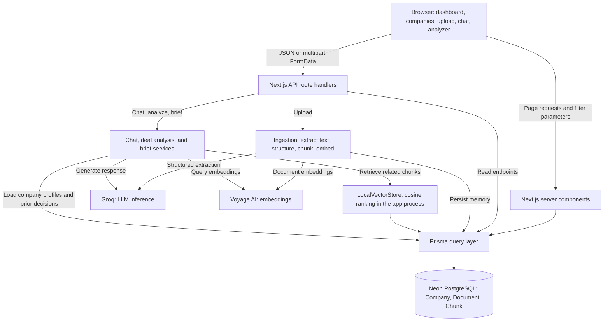
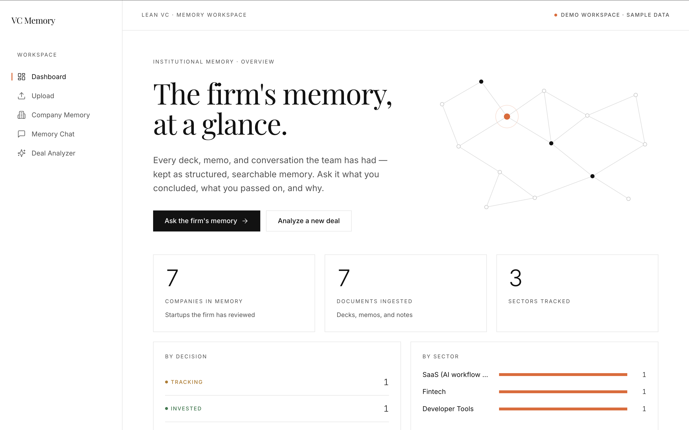
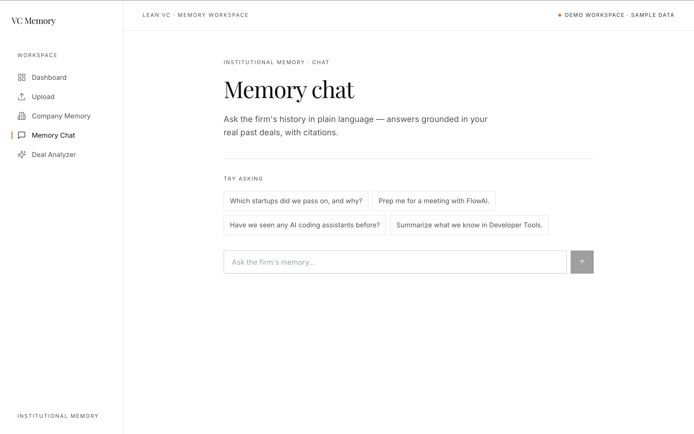
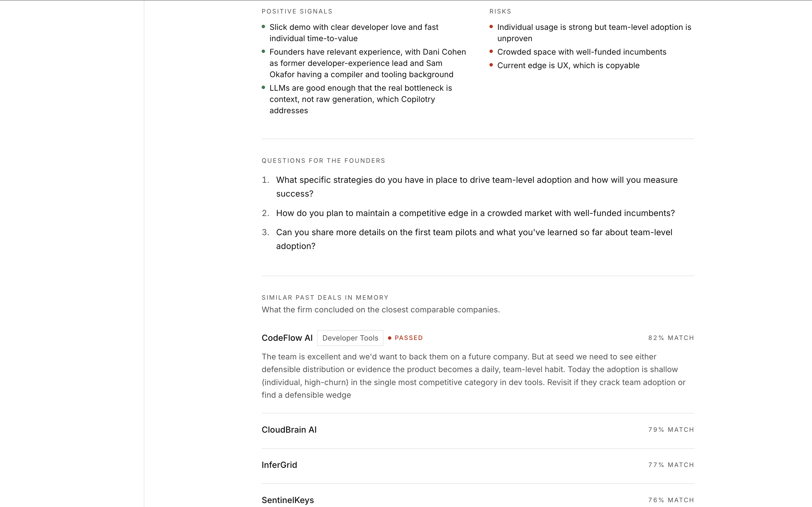

# VC Memory AI: Turning Startup Documents into Searchable Investment Memory

*A technical account of a Project Development Course (PDC) project built with Next.js, PostgreSQL, and retrieval-augmented generation.*

## B. Introduction

VC Memory AI is a web application that helps a venture capital team retain and revisit its knowledge of startups. Users can upload pitch decks, investment memos, and meeting notes; view the extracted intelligence as company records; ask questions about previous interactions; compare a new opportunity with historical deals; and generate an investment brief.

The central idea is to preserve both **what a document says** and **what the firm previously concluded**. A new startup analysis can therefore include a relevant earlier decision and its reasoning, rather than presenting only an isolated summary.

This PDC project implements that idea as a shared demonstration workspace. It combines structured database records with semantic retrieval and AI-generated responses, while keeping the final investment judgment with the user.

## C. Problem Statement

Startup evaluation produces information in different forms: a deck explains the business, meeting notes record questions, and an investment memo captures a decision. When these materials remain separate, finding the history of a company or remembering why a similar deal was rejected becomes difficult.

For example, a firm may have passed on an AI coding assistant because individual usage did not translate into team adoption. When another coding startup arrives, that earlier concern is useful context. A document summary alone does not connect the two evaluations.

The problem addressed by VC Memory AI is how to convert scattered documents into persistent, retrievable institutional memory. Solving it supports meeting preparation, comparison with past opportunities, and access to the reasoning behind previous decisions.

## D. Project Objectives

- Accept PDF, Markdown, and plain-text startup documents.
- Extract structured business information and any recorded investment decision.
- Accumulate information from multiple documents into a company record while retaining each source's contribution.
- Support natural-language questions through retrieval-augmented generation (RAG).
- Compare new startup documents with relevant companies already in memory.
- Generate structured investment briefs with cautious recommendations and visible supporting context.
- Provide a usable demonstration with fictional documents and built-in sample decks.

## E. Technologies Used

The following technologies are present in the repository. Versions below identify the project's major framework and library versions, rather than implying that every dependency range in `package.json` is an exact installed version.

| Technology | Purpose in this project |
| --- | --- |
| TypeScript | Shared types for documents, companies, API results, and AI-generated reports; strict compiler configuration. |
| Next.js 14.2.20 | App Router pages, server components, route handlers, and application build. Frontend and backend belong to one application. |
| React 18 | Interactive upload, chat, analyzer, navigation, and brief components. |
| Tailwind CSS 3 | Responsive layouts and utility styling, supported by CSS variables in `src/app/globals.css`. |
| Inter, Playfair Display, and Lucide React | Interface typography through `next/font/google` and icon components. |
| PostgreSQL on Neon | Persistent company records, extracted document text, and chunk embeddings. |
| Prisma 6 | Database schema, generated client, typed queries, and schema synchronization. |
| Groq and `groq-sdk` | LLM requests for extraction, chat, deal analysis, and investment briefs. The configured default reasoning model is `llama-3.3-70b-versatile`. |
| Voyage AI | Embeddings through its REST API, using `voyage-3.5` by default. |
| Zod 3 | Request validation, validation of parsed model responses, and validation of normalized extracted intelligence. |
| `pdf-parse` | Extracting the text layer from uploaded PDFs. |
| Node.js, npm, `tsx`, and `dotenv` | Server execution, dependency scripts, TypeScript demo ingestion, and environment loading for scripts. |
| ESLint and TypeScript tooling | Repository lint configuration and static type checking support. |
| Vercel | Hosting target documented in `DEPLOY.md`; the production build script runs Prisma generation followed by `next build`. |

The application uses a single Next.js backend and performs vector ranking within the application process. The current Prisma datasource is PostgreSQL.

## F. System Architecture

### One application, two paths to server functionality

Next.js hosts both the interface and server logic. Dashboard and company pages call the database query layer directly while rendering on the server. Interactive client components use HTTP requests to route handlers for uploads and AI operations.

The server integrates two complementary forms of memory:

1. **Structured memory:** company fields such as sector, traction, concerns, and decision reason.
2. **Semantic memory:** document chunks and embeddings used to retrieve passages related to a question or startup profile.



Arrows represent calls and data dependencies; results return through the calling layers. The vector store runs inside the application process. PostgreSQL stores its input vectors as JSON rather than executing a vector-index query.

### Data model

The current [Prisma schema](prisma/schema.prisma) defines three models:

| Model | Information retained | Relationships |
| --- | --- | --- |
| `Company` | Consolidated business intelligence, founders, strengths, risks, concerns, decision and reason, and interaction dates. | One company can have many documents and chunks. |
| `Document` | Filename, file type, extracted `rawText`, byte size, document-specific intelligence, processing status, and error. | Optional company association; owns its chunks. |
| `Chunk` | A text segment, its ordinal position, and an embedding stored as JSON. | Required document association and optional company association. |

Deleting a document cascades to its chunks. Deleting a company sets related company references to null. The schema indexes company filters and document/chunk relationships. Uploaded binary files are not stored by these models; the retained source material is extracted text and metadata.

### API surface

| Method and route | Responsibility |
| --- | --- |
| `POST /api/upload` | Ingest one or more files and return a result for each file. |
| `POST /api/chat` | Answer the current question using retrieved memory. |
| `POST /api/analyze` | Analyze a file or pasted text against existing deals. |
| `POST /api/brief` | Generate a brief for a supplied `companyId`. |
| `GET /api/stats` | Return dashboard counts, breakdowns, and recent uploads. |
| `GET /api/companies` | List companies, optionally filtered by sector, decision, and stage. |
| `GET /api/companies/[id]` | Return an individual company record and its document information. |

The project does not implement login, sessions, authorization, or tenant isolation. The visible workspace is a shared demo, not a separate secured account for each user.

## G. Implementation Approach

The steps below trace the implementation from document input to user-facing output. Code excerpts are taken from the named repository files.

### 1. Establish persistence and configuration

[`src/lib/db/prisma.ts`](src/lib/db/prisma.ts) provides a shared `PrismaClient`. In development, it caches the instance on `globalThis`, avoiding repeated client creation during Next.js hot reload. [`src/lib/db/queries.ts`](src/lib/db/queries.ts) centralizes database operations and converts stored JSON and dates into application-facing results.

The schema uses `DATABASE_URL` for runtime connections and `DIRECT_URL` for Prisma schema operations. Groq and Voyage credentials are read from server environment variables. The model defaults can also be overridden through environment configuration.

For a fresh demonstration database, the repository supports this setup sequence after the variables in `.env.example` have been configured:

```bash
npm install
npx prisma generate
npm run db:push
npm run ingest:demo
npm run dev
```

**Demo reset behavior:** `ingest:demo` deletes existing chunks, documents, and companies in the configured database before loading the sample corpus. It calls the real AI and embedding services. It should therefore be run against an intended demo database, not used as a harmless read-only check.

### 2. Convert uploaded documents into stored memory

[`Dropzone.tsx`](src/components/upload/Dropzone.tsx) supports browsing, drag-and-drop, multiple files, and built-in sample documents. It displays processing, success, or failure for each file. The upload route checks extensions, empty files, and the configured size ceiling of `15 * 1024 * 1024` bytes per file. Accepted extensions are `.pdf`, `.txt`, and `.md`.

[`extractText()`](src/lib/ingest/extract-text.ts) decodes text files as UTF-8 and uses `pdf-parse` for PDFs. It normalizes whitespace and rejects content with fewer than 20 non-whitespace characters. There is no OCR stage, so an image-only PDF produces an explanatory error rather than useful extracted text.

[`ingestDocument()`](src/lib/ingest/pipeline.ts) then creates a `Document` in `processing` state, extracts intelligence, merges the company record, and links the source to that company. The semantic indexing stage is:

```typescript
const chunks = chunkText(text);
const vectors = await embedInBatches(chunks);
await saveChunks(
  doc.id,
  company.id,
  chunks.map((content, i) => ({ content, ordinal: i, embedding: vectors[i] }))
);

// 7. Done.
await setDocumentStatus(doc.id, "processed");
```

If a later stage fails, the pipeline attempts to mark the document `failed` and record the error. Files receive independent results, so a failed file does not prevent later files in the batch from being attempted. The stages are not one atomic transaction: a company update can already have occurred before an embedding failure.

### 3. Validate and normalize AI extraction

[`extractIntelligence()`](src/lib/ai/extract.ts) asks Groq for fields such as company, sector, stage, founders, problem, traction, strengths, risks, concerns, and any recorded decision. Prompts instruct the model to omit unsupported details.

The central [`completeJSON()`](src/lib/ai/llm.ts) helper requests JSON-object mode, parses the response, and applies a supplied Zod schema. If that parsing or validation fails, it adds corrective feedback and makes one further attempt. The implementation currently disables its strict JSON-schema branch; it does not automatically switch to constrained decoding.

Extraction first validates a permissive model response requiring a company name. It then normalizes optional fields and applies the final application schema:

```typescript
const raw = await completeJSON(prompt, llmOutputSchema, {
  system: EXTRACTION_SYSTEM,
  jsonSchema: EXTRACTION_SCHEMA as unknown as Record<string, unknown>,
  schemaName: "investment_intelligence",
  maxTokens: 2000,
  temperature: 0.1,
});

const normalized = normalize(raw);
// Final strict guard — should always pass once normalized.
return extractedIntelligenceSchema.parse(normalized) as ExtractedIntelligence;
```

Normalization trims strings, handles supported founder representations, filters list values, and maps decisions to the application's vocabulary. This keeps downstream components from depending directly on an unpredictable model response shape. Schema validation checks structure; it does not prove that an extracted statement is factually correct.

### 4. Accumulate company knowledge across sources

`upsertCompanyFromExtraction()` searches for an existing company using trimmed, lowercased names with repeated whitespace normalized. It refreshes scalar fields only when the new extraction provides a non-empty value. Strengths, risks, and concerns are combined and deduplicated case-insensitively. Founder records are merged by name while preserving known role and background information.

This supports a deck, memo, and meeting note contributing to one company profile. The separate `Document.intelligence` values preserve what each source contributed, which the company detail page displays alongside the aggregate record.

Matching is not fuzzy entity resolution: a spelling change or a difference such as `NimbusHealth` versus `Nimbus Health` can still produce separate records. The lookup and write are also not protected by a unique normalized-name constraint.

### 5. Build semantic retrieval with embeddings and cosine similarity

[`chunkText()`](src/lib/ingest/chunk.ts) defaults to chunks of approximately **1,200 characters**, with **200 characters of overlap**. It prefers nearby paragraph, sentence, or whitespace boundaries. Overlap preserves some neighboring context when a relevant passage spans a split.

[`src/lib/embeddings/voyage.ts`](src/lib/embeddings/voyage.ts) calls `https://api.voyageai.com/v1/embeddings` using `fetch`. Stored passages use `input_type: "document"`; questions and comparison profiles use `"query"`. Ingestion batches up to 96 chunks per embedding request.

[`LocalVectorStore.search()`](src/lib/vector/local-store.ts) loads candidate chunks through Prisma, calculates cosine similarity, sorts the scores, and returns the top results. Its underlying similarity function is:

```typescript
export function cosineSimilarity(a: number[], b: number[]): number {
  const m = magnitude(a) * magnitude(b);
  return m === 0 ? 0 : dot(a, b) / m;
}
```

This implementation avoids a separate vector service, but it scans candidate embeddings in application memory. It has no approximate nearest-neighbor index or minimum relevance threshold. The `VectorStore` interface provides a place to introduce a different retrieval implementation later.

### 6. Reuse memory for chat, analysis, and briefs

**Memory chat.** `answerFromMemory()` embeds the current question, retrieves six chunks, labels the passages, and includes them in a grounded prompt. It returns an answer and up to five company-level citations with snippets. If retrieval returns no chunks, it returns an empty-memory message without making an LLM completion request. Citations represent retrieved sources; they are not verified sentence-level or PDF-page-level attributions.

**Deal analysis.** `analyzeNewDeal()` embeds the first 6,000 characters of a new document for retrieval, selects 16 chunks, and groups them by company using each company's highest score. It keeps up to four comparable companies and supplies their decisions and reasoning to the LLM alongside the new document. The response includes a summary, positive signals, risks, founder questions, and a cautious recommendation. Analysis does **not** add the new document to memory.

**Investment briefs.** `generateBrief()` loads an existing company's accumulated profile and searches for comparables while excluding that company. It uses 16 retrieved chunks to select up to three other companies. The resulting brief covers the company overview, problem, solution, market, founder signals, traction, strengths, risks, questions, and recommendation. The prompt asks for unknown sections to be identified rather than invented. Briefs are returned to the client and are not persisted.

All three workflows use prompt instructions that preserve human investment judgment. Those instructions guide model behavior; they do not guarantee error-free generation.

### 7. Connect the interface to server operations

Interactive components use standard `fetch` calls. For example, [`ChatWindow.tsx`](src/components/chat/ChatWindow.tsx) sends the current question as JSON:

```typescript
const res = await fetch("/api/chat", {
  method: "POST",
  headers: { "Content-Type": "application/json" },
  body: JSON.stringify({ message: q }),
});
```

Displayed chat turns remain in React state. Earlier turns are not sent with the next question, and the current schema contains no conversation or message models. The interface therefore presents a chat history during use, but the backend processes each question independently.

Uploads and analyzer submissions use multipart `FormData`. Company filters update URL parameters, after which the server-rendered company page calls `listCompanies()` with those filters. The dashboard similarly calls `getDashboardStats()` directly; it does not fetch its own `/api/stats` endpoint.

The interface uses a shared shell, sidebar, headers, cards, and decision badges. The desktop sidebar becomes a drawer at smaller screen sizes. `GenerateBriefButton.tsx` renders a brief through a portal to `document.body` and invokes `window.print()` for printing or saving as PDF through the browser. There is no dedicated server-side PDF export service.

The four AI route handlers select the Node.js runtime and export `maxDuration = 60`. This is a hosting configuration, not a measured response time or a guarantee that every retry sequence finishes within that duration.

## H. Screenshots and Visual Demonstrations

The following three PNG files already exist in the repository. They document captured demo states rather than a newly executed test session.

### Dashboard



*Figure 1. The dashboard combines workspace navigation, summary counts, and decision/sector breakdowns. Visible counts belong to this screenshot's dataset, not a fixed application result. The introductory node graphic is decorative SVG, not a database-generated knowledge graph.*

### Memory Chat: initial screen



*Figure 2. The initial chat screen offers example questions and a composer. This existing image does not show a generated answer or its citations.*

> **SCREENSHOT PLACEHOLDER — Answer with sources:** After loading the demo corpus, open `/chat` and ask “Which startups did we pass on, and why?” Capture the returned answer and visible Sources links. Add the actual capture here; no answered-chat image is currently supplied for this document.

### Deal Analyzer: comparable past deals



*Figure 3. A scrolled analyzer result shows assessment sections and historical comparisons, including CodeFlow AI with its recorded Passed decision and reasoning. Displayed match percentages derive from retrieval similarity; they are not prediction accuracy or measured model confidence.*

### Additional screens to capture

| Placeholder | Capture instructions |
| --- | --- |
| **SCREENSHOT PLACEHOLDER — Document ingestion** | Open `/upload`, ingest one fictional sample, and capture the successful per-file result with extracted company information. |
| **SCREENSHOT PLACEHOLDER — Company Memory filters** | Open `/companies`, apply a sector or decision filter, and capture the selected filter with matching company cards. |
| **SCREENSHOT PLACEHOLDER — Company detail and source contributions** | Ingest at least two documents about the same company, then capture its accumulated intelligence and separate document contributions. The Nimbus Health deck, memo, and notes in `data/samples/` provide suitable inputs. |
| **SCREENSHOT PLACEHOLDER — Investment brief** | On a company detail page, generate a brief and capture the report with its Print and Regenerate controls. |

For publication, upload the referenced images into the destination editor, replace the marked placeholders with real captures, and include an exported diagram image if the editor does not render Mermaid. Use fictional demo data in these captures.

## I. Key Features and Outcomes

| Implemented feature | Result provided to the user |
| --- | --- |
| Document ingestion | Supported source text becomes stored documents, structured intelligence, and searchable embedded chunks. |
| Company memory | Related documents contribute to a consolidated record while retaining per-source extracted information. |
| Dashboard and filters | Counts, decision/sector breakdowns, recent uploads, and filtered company browsing make the stored corpus accessible. |
| Retrieval-based chat | Natural-language questions produce responses with links and snippets from retrieved company sources. |
| New-deal comparison | A new document can be evaluated alongside historical decisions without automatically changing the stored corpus. |
| Investment brief | Stored company intelligence and comparable deals become a structured report with browser printing. |

The demo loader in [`scripts/ingest-demo.ts`](scripts/ingest-demo.ts) sends five fictional historical deal documents through the real pipeline: LedgerLite, CloudBrain AI, CodeFlow AI, FlowAI, and VaultGuard. `data/demo/devai-newdeal.md` is deliberately excluded so it can serve as a new-deal input without retrieving itself from the seed corpus.

The interface also provides NovaLedger, Copilotry, and GridServe sample decks in `src/config/sample-decks.ts`. Their content is designed to demonstrate comparisons with existing records. The actual ranking still depends on embeddings and the stored corpus.

These outcomes describe implemented behavior and the supplied visual evidence. The repository contains no automated test suite or recorded benchmark establishing extraction accuracy, response latency, or time saved. No such measurements are claimed here, and this documentation review did not rerun the live AI workflows.

## J. Challenges and Learnings

### Handling variable model outputs

The normalization helpers and corrective retry in `extract.ts` and `llm.ts` address inconsistent optional fields, founder representations, and decision values. The engineering lesson is that an AI integration needs explicit data contracts and validation between generation and persistence.

### Preserving context without duplicating company results

Overlapping chunks retain neighboring text, while analyzer and brief retrieval group chunk matches by company. This separates passage-level search from company-level presentation: several related passages from one startup should not occupy every comparable-deal position.

### Managing external service failures

The Voyage client retries HTTP 429 and server errors, honors a positive numeric `Retry-After`, and otherwise uses configured backoff behavior. Sequential uploads provide incremental feedback while limiting bursts of requests. These mechanisms address throttling, but long retries can still exceed a serverless request budget.

A separate deployment investigation for this project exposed a Neon quota-exceeded error. Because the dashboard queries the database during server rendering, a database outage can become a page-level exception. The lesson is to monitor dependency availability and quotas alongside application errors; moving application code alone does not remove those dependencies.

### Printing a report from an overlay

Comments in [`globals.css`](src/app/globals.css) document a printing problem in which a fixed overlay repeated the first page. The print styles hide unrelated body content and make the brief overlay and sheet participate in normal document flow. Together with the portal-based report component, this supports natural pagination through the browser print dialog.

### Balancing accumulated knowledge and source context

The company merge policy preserves existing information when a new source omits a field and combines list values across documents. Retaining each document's extracted intelligence separately also makes the aggregate easier to interpret. A useful learning is that a consolidated record should preserve access to its source context; recording changes and resolved concerns remains a future improvement.

## K. Future Scope

The following are proposed improvements, not features of the current application:

- **Authentication and workspace ownership:** add user accounts, authorization, and tenant-scoped queries before supporting private firm data.
- **Persistent, contextual chat:** save sessions and include appropriate prior turns when answering follow-up questions.
- **Indexed retrieval and evaluation:** replace full candidate scans with a vector index, evaluate relevance thresholds and hybrid search, and measure retrieval and answer quality on a labeled dataset.
- **Durable ingestion jobs:** use a queue with resumable stages and idempotent writes so API backoffs and partial failures do not depend on one HTTP request.
- **Stronger entity identity and provenance:** enforce suitable company identity constraints, handle name variants, version changing facts, and distinguish unresolved concerns from historical ones.
- **Broader document support:** add OCR for scanned PDFs and optional object storage for original files, with explicit source/page references where available.
- **Operational resilience:** expose a health endpoint, add page-level error recovery, monitor provider quotas, and add integration tests covering ingestion, retrieval, and unavailable services.

## L. Conclusion

VC Memory AI demonstrates how document processing, structured persistence, semantic retrieval, and language generation can work together in one full-stack application. Its central contribution is the connection between a new evaluation and the firm's recorded history, including earlier decisions and their reasoning.

As a PDC project, it brings together frontend interaction, server APIs, database modeling, external AI integration, and failure handling. The current implementation is a shared demo prototype, with clear paths toward stronger access control, retrieval evaluation, and operational reliability.

## Final College Submission Checklist

- [x] Professional project title and introduction included.
- [x] Problem statement and project objectives explained.
- [x] Technologies and their actual roles identified from the repository.
- [x] Architecture, component communication, data model, and API routes documented.
- [x] Implementation explained through actual modules and selected source excerpts.
- [x] Mermaid architecture diagram included.
- [x] Three existing screenshots embedded with accurate captions.
- [x] Missing visual demonstrations marked with specific capture instructions.
- [x] Implemented features and outcomes distinguished from future proposals.
- [x] Challenges and learnings tied to code or the observed project investigation.
- [x] No invented metrics, test results, authentication, or persistent chat features claimed.
- [x] Grammar, Markdown structure, source links, and code excerpts reviewed.
- [x] Application code and configuration left unchanged; only this blog document created.
